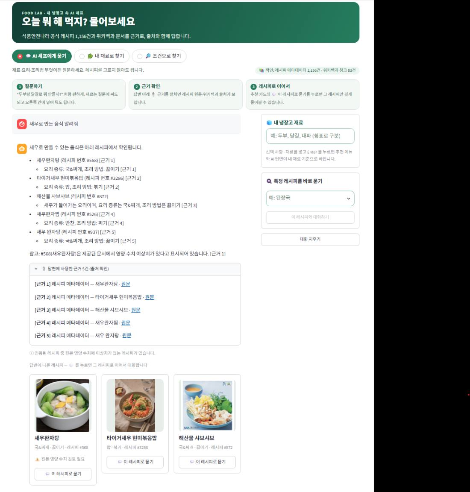
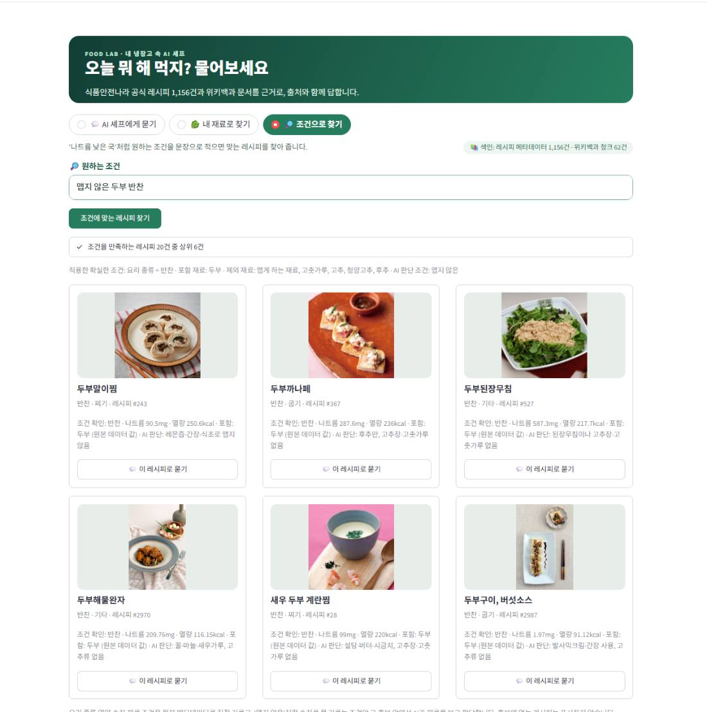
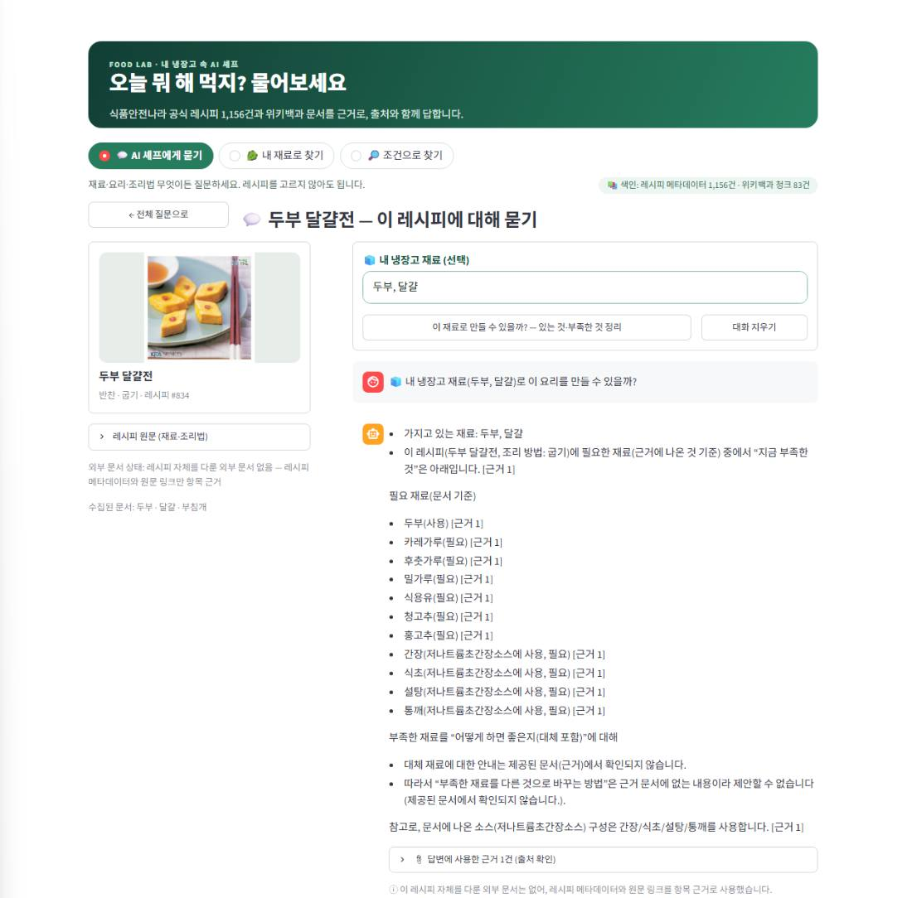

# Food Lab RAG

냉장고에 있는 재료나 먹고 싶은 음식을 물어보면 식품안전나라 공식 레시피와 위키백과 문서에서 근거를 찾아 출처와 함께 답해 주는 RAG 서비스입니다.

- 기간: 2026.10.21 ~ 10.23 (개인 프로젝트, SSAFY AI 코어 프로젝트 2회차)
- 기술: Python, LangChain, LangGraph, ChromaDB, Streamlit



## 개발 배경

LLM에게 레시피를 물어보면 재료나 분량을 그럴듯하게 지어내는 경우가 많습니다. 공식 레시피 데이터를 근거로만 답하게 하고, 답에 쓴 근거가 어디서 왔는지 화면에서 바로 확인할 수 있게 만드는 것이 목표였습니다.

- 레시피를 먼저 고르지 않아도 "두부랑 달걀로 뭐 만들지?"처럼 바로 질문할 수 있습니다.
- 가진 재료 기준으로 있는 것, 없는 것, 대체 가능 여부를 정리합니다. 대체 재료는 문서에 있을 때만 말합니다.
- 문서에 없는 질문에는 "제공된 문서에서 확인되지 않습니다"라고 답합니다.

## 데이터

| 출처 | 내용 | 이용 조건 |
|---|---|---|
| 식품안전나라 조리식품 레시피 DB (COOKRCP01) | 레시피 1,156건 (재료, 만드는 법, 영양 정보) | 공공데이터, 출처 표시 |
| 한국어 위키백과 | 질문할 때 음식·재료·조리법 문서를 찾아서 수집 | CC BY-SA 4.0, 청크마다 URL과 라이선스 저장 |

- 원본 데이터는 용량 때문에 저장소에 넣지 않았습니다. `python data_check/check_data.py`로 받을 수 있습니다 (`.env`에 `FOODSAFETY_API_KEY` 필요).
- 영양 수치가 이상한 91건은 지우지 않고 "검토 필요"로 표시만 했습니다.
- 식약처 『삼삼한 밥상』 PDF가 54개 레시피의 원문인 것은 확인했지만, 이용 조건이 문서마다 다르게 읽혀서 색인하지 않았습니다.

## 서비스 구조

```
질문 → 검색어 추출(LLM) → 위키 문서 수집·선별 → 청크 색인
     → 레시피 메타데이터 + 위키 청크 검색 → 근거 병합 → 답변 생성(LangGraph retrieve → generate)
```

1. 재료 원문을 주재료, 양념, 고명으로 나누는 파서를 직접 만들었습니다.
2. 레시피 1건을 검색용 텍스트 하나로 만들어 `recipe_meta` 컬렉션에 넣었습니다. ID가 고정이라 다시 돌려도 중복이 생기지 않고, 바뀐 레시피만 다시 임베딩합니다.
3. 질문이 들어오면 위키백과에서 관련 문서를 찾아 1,000자 / 200자 겹침으로 나눠 `external_docs` 컬렉션에 넣습니다. 이미 찾은 검색어와 문서는 다시 수집하지 않습니다.
4. 검색 결과는 레시피 메타데이터를 항상 1번 근거로 두고 위키 Top-k를 붙입니다. 답변이 실제로 인용한 근거만 화면에 보여 줍니다.
5. "맵지 않은 두부 반찬" 같은 조건 탐색은 종류, 나트륨, 재료처럼 데이터에 있는 조건은 코드로 거르고, 판단이 필요한 조건만 LLM이 봅니다. "15분 안에"처럼 데이터에 없는 조건은 판단하지 않았다고 알려 줍니다.

자세한 설계는 [RAG 파이프라인 설계문서](docs/RAG_파이프라인_설계문서.md)에 있습니다.

## 테스트 및 결과

| 조건 탐색 | 냉장고 재료 기준 가이드 |
|---|---|
|  |  |

- 색인: 1,156건 색인(수집 기준, 고유 레시피 1,149건), 다시 실행하면 임베딩 요청 0회
- 같은 질문을 다시 하면 LLM·위키 요청 0회 (검색어와 문서 캐시)
- 조건 탐색: "맵지 않은 두부 반찬" → 6개 모두 반찬, 두부 포함, 고추류 없음
- MMR: "두부 대신 쓸 수 있는 재료는?"에서 유사도 검색은 두부 문서 청크가 몰렸는데, MMR은 두부 대체 재료인 "밀고기" 문서를 새로 가져왔습니다.
- 응답 시간: 일반 질문 약 4초, 위키 수집이 필요한 질문 약 14초
- 자동 테스트 13개 통과 (가짜 LLM·임베딩 사용, 외부 요청 없음)

전체 검증 내용은 [검증 결과](docs/검증결과.md)에 있습니다.

## 개발 중 해결한 문제

- Windows에서 ChromaDB가 한글 경로에 벡터 파일을 못 써서 다음 실행 때 색인이 안 열렸습니다. 저장 위치를 영문 경로로 옮겨서 해결했습니다.
- LLM이 같은 질문에도 매번 다른 검색어를 만들어서 재수집이 일어났습니다. 질문별로 검색어를 저장해 두고 재사용하게 바꿨습니다.
- 조건 탐색을 처음엔 LLM에 다 맡겼더니 후식이 섞이거나 결과가 0건이 나왔습니다. 그래서 코드로 거를 조건과 LLM이 볼 조건을 나눴습니다.

자세한 내용은 [개발 기록](docs/개발기록.md)에 있습니다.

## 실행 방법

```bash
python -m venv .venv
source .venv/Scripts/activate          # Windows Git Bash
pip install -r requirements.txt
cp .env.example .env                   # GMS_KEY, WIKI_CONTACT, FOODSAFETY_API_KEY 입력

python data_check/check_data.py        # 레시피 원본 받기
python check_gms.py --save             # 사용할 임베딩 모델 확인
python build_index.py --verify         # 레시피 색인
streamlit run app.py
```

테스트: `python -m unittest discover -s tests`

## 저장소 구성

```
├─ app.py              Streamlit 화면
├─ build_index.py      레시피 색인
├─ ask_cli.py          터미널에서 RAG 단계별 확인, Top-k·MMR 비교
├─ check_*.py          GMS 모델, ChromaDB 저장 위치, 청크 설정 점검
├─ config.json         모델, 청크, Top-k, 요청 상한
├─ foodlab/            데이터, 수집, 색인, 검색, 생성 모듈
├─ data_check/         원본 데이터 수집 스크립트
├─ tests/              테스트
└─ docs/               요구사항 정의서, 설계문서, 검증 결과, 개발 기록
```

건강·영양 정보는 의료적 조언을 대신하지 않습니다.
