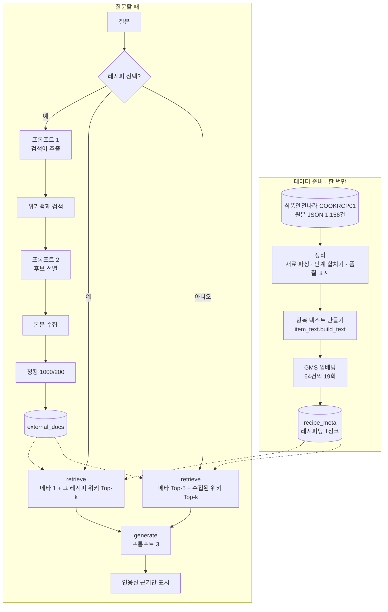
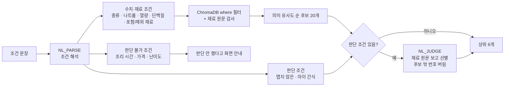

# RAG 파이프라인 설계문서 · Food Lab

요구사항 정의서 2장(2.2 ~ 2.6)에서 정하라고 한 것들을 어떻게 정했는지 정리한 문서입니다. 실제 코드 위치도 같이 적었습니다.

<br>

## 1. 전체 흐름



LangGraph는 레시피 대화용과 일반 질문용 두 개를 만들었고, 둘 다 `retrieve → generate` 두 노드입니다 (`foodlab/rag.py`).

```
graph TD;
  __start__ --> retrieve;
  retrieve --> generate;
  generate --> __end__;
```

<br>

## 2. 항목 텍스트 설계 (정의서 2.2)

사용자가 레시피를 무엇으로 찾을지를 먼저 생각했습니다. 이름으로도 찾지만, "두부 들어간", "찜 요리", "나트륨 낮은", "아이 간식" 같은 재료·조리법·영양·분위기로 찾는 경우가 많습니다. 그래서 이것들을 전부 한 텍스트에 넣었습니다.

| 들어가는 속성 | 넣은 이유 |
|---|---|
| 이름, 레시피 번호 | 이름 검색, 같은 이름 14건 구분 |
| 요리 종류, 조리 방법 | "국 추천", "찜 요리" 같은 검색 |
| 주요 재료 / 양념·육수 / 고명 (파서로 구분) | "두부 들어간 반찬" 같은 재료 검색. 양념을 따로 두어 주재료가 묻히지 않게 함 |
| 재료 원문 | 파서가 놓친 표현까지 검색되게, 그리고 답변에서 분량을 그대로 인용하게 |
| 만드는 법 | "오븐 없이", "10분 찐다" 같은 조리 과정 검색 |
| 영양 정보 (+ 이상치 주의 문구) | "나트륨 낮은" 검색, 답변에서 수치 인용 |
| 저감 조리 팁, 해시태그 | 식약처가 단 설명이라 "저염", "아이 간식" 같은 의도 검색에 걸림 |
| 출처 | 근거가 어디서 왔는지 텍스트 안에도 남김 |

실제 예시 (`python build_index.py --dry-run` → `index_preview.txt`):

```
[레시피] 새우 두부 계란찜 (레시피 번호 28)
요리 종류: 반찬 / 조리 방법: 찌기
주요 재료: 연두부, 칵테일새우, 달걀, 생크림, 설탕, 무염버터
고명·곁들임: 시금치
재료 원문: 새우두부계란찜 / 연두부 75g(3/4모), 칵테일새우 20g(5마리), 달걀 30g(1/2개), ...
만드는 법: 1) 손질된 새우를 끓는 물에 데쳐 건진다. 2) 연두부, 달걀, 생크림, ... 3) ... 10분 정도 찐다.
영양정보(원본 표기, 1인분): 열량 220kcal, 탄수화물 3g, 단백질 14g, 지방 17g, 나트륨 99mg
저감 조리 팁: 나트륨의 배출을 도와주는 것으로 알려진 칼륨이 풍부한 시금치와 ...
해시태그: 연두부
출처: 식품의약품안전처 식품안전나라 조리식품의 레시피 DB(COOKRCP01)
```

텍스트 길이는 최소 378자, 중간값 648자, 최대 1,346자라서 레시피 하나를 청크 하나로 넣어도 됩니다. 쪼개면 재료와 영양 정보가 서로 다른 청크로 갈라져서 오히려 불리합니다.

<br>

## 3. 컬렉션과 메타데이터 설계 (정의서 2.3)

컬렉션은 두 개로 나눴습니다. ChromaDB, 거리 기준은 코사인입니다.

### 3-1. `recipe_meta` (항목 메타데이터)

| 항목 | 값 |
|---|---|
| 단위 | 레시피 1건 = 1청크 (1,156개) |
| ID | `recipe:{RCP_SEQ}` (고정이라 다시 색인해도 덮어쓰기만 됨) |
| 메타데이터 | `rcp_seq`, `name`, `display_name`, `category`, `method`, `main_ingredients`, `kcal`, `carb_g`, `protein_g`, `fat_g`, `sodium_mg`, `flags`, `nutrition_suspect`, `source_type`, `source_label`, `source_url`, `text_version`, `raw_sha256`, `content_hash` |
| 컬렉션 메타데이터 | `embedding_model` (다른 모델로 만든 벡터가 섞이지 않게 막는 데 씀) |

영양 수치와 `category`, `nutrition_suspect`를 숫자·불리언으로 따로 넣은 이유는 조건 탐색(F2011)에서 `where` 필터로 바로 거르기 위해서입니다.

### 3-2. `external_docs` (외부 문서)

| 항목 | 값 |
|---|---|
| 단위 | 위키백과 문서를 1,000자 / 200자 겹침으로 나눈 청크 |
| ID | `{RCP_SEQ}:wiki-{pageid}:{순번 3자리}` 예: `28:wiki-48731:005` |
| 메타데이터 | `rcp_seq`, `doc_id`, `doc_title`, `source_url`, `source_type`(wikipedia), `source_label`, `license`(CC BY-SA 4.0), `relation`, `selected_by`, `query`, `chunk_index`, `chunk_hash`, `revision`, `collected_at` |

- **`rcp_seq`가 제일 중요합니다.** 검색할 때 `where={"rcp_seq": 선택한 레시피}`로 범위를 좁히는 데 써서, 다른 레시피용으로 모은 문서가 근거에 섞이지 않습니다.
- **ID에 레시피 번호를 넣은 이유:** 두부 문서를 28번과 231번이 둘 다 수집해도 서로 덮어쓰지 않게 하려고요. 대신 같은 본문은 `chunk_hash`로 확인해서 임베딩을 다시 하지 않고 재사용합니다.
- **`relation`:** 이 문서가 레시피와 어떤 관계인지입니다. 음식 배경(FOOD_BACKGROUND), 재료 배경(INGREDIENT_BACKGROUND), 조리법(COOKING_METHOD) 중 하나이고, 화면 근거 목록에 표시됩니다.
- **`selected_by`:** 이 문서를 누가 골랐는지 남깁니다. 프롬프트 2가 골랐으면 `prompt2`, 레시피 이름과 같은 제목이라 강제로 넣었으면 `item_self_rule`입니다.

<br>

## 4. 프롬프트 설계 (정의서 2.4)

프롬프트는 `foodlab/prompts.py`에 모아 두었고, 출력은 전부 파싱할 수 있는 JSON입니다 (답변 생성만 문장).

### 프롬프트 1 · 검색어 추출 (F2003)

- 역할: "한식과 식재료에 밝은 요리 연구가이자 자료 조사 담당자"
- 입력: 레시피 이름·종류·조리법·주재료, 최근 대화, 질문
- 출력: `["두부", "달걀", "찜"]` 같은 JSON 배열, 1~4개, 위키 문서 제목 같은 짧은 명사구
- 코드에서 보정: 레시피 이름은 LLM 결과와 상관없이 **항상 첫 검색어**로 넣습니다. LLM 호출이 실패하면 주재료 2개로 대신합니다.
- 캐시: 같은 레시피·같은 질문·같은 대화 맥락이면 저장해 둔 결과를 씁니다. LLM은 같은 질문에도 매번 조금 다른 검색어를 만들어서, 이게 없으면 같은 질문인데 재수집이 일어났습니다.

### 프롬프트 2 · 후보 문서 선별 (F2004)

- 역할: "근거 문서를 고르는 편집자"
- 입력: 레시피, 질문, 후보 문서의 **제목과 요약(120자)만**
- 출력: `[{"title", "relation", "reason"}]`, 최대 3개
- 규칙: 제목이 비슷하다는 이유만으로 고르지 않기, 사람·지명·기업·방송·작품·동음이의 문서 빼기
- 선별을 따로 둔 이유: 정의서에 나온 대로, 본문을 받기 전에 버릴 문서를 정하면 위키 요청이 줄어듭니다. 실제로 "두부 보관"을 검색하면 서울대학교, 도널드 트럼프 2기 행정부 같은 문서가 섞여 나오는데, 본문을 받기 전에 다 걸러졌습니다.
- 코드에서 보정:
  - 레시피 이름과 같은 제목의 문서는 프롬프트 2 결과와 상관없이 강제로 포함합니다 (`item_self_rule`).
  - PHASE 1-B에서 오인 매칭으로 판정한 위키 제목 32개(REJECTED 21, AMBIGUOUS 11)는 후보에서 미리 뺍니다.
  - 동음이의 문서도 뺍니다.

### 프롬프트 3 · 답변 생성 (F2007)

- 역할: "푸드랩 AI 셰프"
- 규칙
  1. 근거에 없는 사실은 말하지 않음. 답할 수 없으면 "제공된 문서에서 확인되지 않습니다."
  2. 근거에서 가져온 문장 끝에 `[근거 N]`
  3. 분량·순서·영양 수치는 레시피 메타데이터 그대로, '주의' 표시가 있으면 함께 알림
  4. 질병 치료·처방·의학적 판단 금지
  5. 마크다운 제목과 굵은 글씨 금지 (한글 조사가 붙으면 화면에서 깨져서)
- 일반 질문용(`P3G`)에는 "근거에 있는 레시피만 이름과 번호로 추천", "냉장고 재료가 들어가는 것과 부족한 것을 근거 재료 목록대로 구분"을 더했습니다.

### 그 밖의 프롬프트

| 이름 | 쓰는 곳 | 내용 |
|---|---|---|
| `FRIDGE_QUESTION` | F2010 냉장고 가이드 | 있는 재료·부족한 재료·대처 방법을 묻는 질문 틀. 대체 재료는 근거에 있을 때만. 화면 말풍선에는 짧은 문장만 표시 |
| `NL_PARSE` | F2011 조건 해석 | 문장을 `category`, `low_sodium`, `max_kcal`, `include`, `exclude`, `judge`(판단 조건), `unsupported`(판단 불가 조건)로 바꿈 |
| `NL_JUDGE` | F2011 판단 | 필터를 통과한 후보의 재료 원문을 보고 판단 조건("맵지 않은")에 맞는 것만 고름. 후보에 없는 번호는 코드에서 버림 |

<br>

## 5. 검색 설정 설계 (정의서 2.5)

바꿔서 비교할 수 있게 전부 `config.json`에 두었습니다.

| 설정 | 값 | 정한 이유 |
|---|---|---|
| `chunk_size` / `chunk_overlap` | 1000 / 200 | 위키 문단 하나가 대체로 한 청크에 들어가는 크기. 500/100으로 하면 청크 수가 53개에서 100개로 늘고 문맥이 끊김 (검증결과 4.2) |
| `top_k_external` | 4 | 메타데이터 1개 + 위키 4개 = 근거 5개. 8로 하면 같은 두부 문서 청크만 늘어남 (검증결과 4.3) |
| `mmr` | false (선택) | true면 후보를 Top-k의 3배 가져와 다양성 기준으로 고름. 비교 결과는 검증결과 F2014 |
| `wiki_search_limit` | 5 | 검색어당 후보 5개 |
| `wiki_max_docs_per_question` | 3 | 질문당 새로 색인할 문서 최대 3개 |
| `wiki_max_requests_per_question` | 12 | 질문 하나가 위키 요청을 너무 많이 쓰지 않게 |
| `request_interval_sec` | 0.5 | 위키 요청 간격 |
| `embedding_batch_size` | 64 | 1,156건을 19번 요청으로 |
| `embedding_max_requests_per_run` | 40 | 색인 한 번에 임베딩 요청 상한 (계획 19회의 약 2배, 재시도 여유) |
| `embedding_model` | text-embedding-3-small | `check_gms.py`로 GMS에서 되는 모델을 요청 1회로 확인하고 저장 |
| `chat_model` | gpt-5.4-nano | 실습에서 쓰던 모델 |

일반 질문 화면은 레시피 메타데이터 Top-5를 가져옵니다. 레시피를 추천하는 질문이 많아서 위키보다 레시피 후보가 더 필요했습니다.

<br>

## 6. 서비스 기능과 화면 설계 (정의서 2.6)

### 6-1. 화면 구성

| 화면 | 하는 일 | 쓰는 근거 |
|---|---|---|
| 💬 AI 셰프에게 묻기 (첫 화면) | 레시피를 안 골라도 질문. 예시 질문 버튼, 오늘의 추천 메뉴, 내 재료 기반 추천 카드 | recipe_meta Top-5 + 수집된 external_docs |
| 💬 레시피 하나와 대화 | 질문마다 위키 수집 → 답변. 레시피별 대화 기록. 냉장고 가이드 버튼 | 선택 레시피 메타 + 그 레시피의 external_docs |
| 🥬 내 재료로 찾기 | 재료 점수순 추천 (MVP v0.2 유지, 점수 계산 수정) | 원본 메타데이터 (LLM 안 씀) |
| 🔎 조건으로 찾기 | 자연어 조건으로 레시피 찾기 → 카드에서 대화로 | recipe_meta 필터 + 의미 검색 + LLM 판단 |

### 6-2. 도메인 특화 기능 (F2010) · 냉장고 맞춤 조리 가이드

레시피 대화 화면에서 냉장고 재료를 넣고 "이 재료로 만들 수 있을까?"를 누르면, 레시피 대화와 같은 RAG(수집 → retrieve → generate)를 거쳐 아래를 근거 번호와 함께 정리합니다.
- 내 재료 중 이 레시피에 실제로 들어가는 것
- 부족한 재료
- 대체 재료 (근거 문서에 있을 때만, 없으면 "확인되지 않음")

### 6-3. 조건 기반 탐색 (F2011)

처음에는 LLM이 후보 20개 중에서 조건에 맞는 걸 다 고르게 했는데, 데이터에 없는 "15분"까지 판단하다가 후식을 섞거나 0건을 냈습니다. 그래서 조건을 세 종류로 나눴습니다.



- "나트륨 적은"처럼 숫자가 없는 조건은 영양 이상치가 아닌 레시피들의 중앙값(나트륨 164mg 등)을 기준으로 씁니다. 수치 조건을 쓸 때는 영양 이상치 레시피를 뺍니다.
- 제외 재료는 주재료뿐 아니라 양념까지 포함한 재료 원문 전체에서 찾습니다. 후추·고춧가루는 양념이라서요.
- 결과 카드의 설명은 원본 값(종류·나트륨·열량)을 먼저 보여 주고, AI 판단 이유는 따로 표시합니다.

### 6-4. 화면 안내 (F2012)

| 상황 | 안내 |
|---|---|
| 문서 수집 중 | "관련 문서를 찾고 있습니다…" 상태 표시. 검색어 고르기 → 위키 검색 → 후보 선별 → 본문 수집 단계와 새로 색인한 문서 제목 |
| 답변 생성 중 | "답변을 만드는 중…" → 끝나면 "근거 N건 검색 · 인용 M건" |
| GMS_KEY 없음 | 경고 + AI 기능 비활성 + 상태 다시 확인 버튼 |
| 임베딩 모델 미설정 | `check_gms.py --save` 실행 안내 |
| 색인 없음 | `build_index.py` 실행 안내 + 상태 다시 확인 버튼 |
| 위키 수집 실패 | "외부 문서 검색 실패 — 레시피 메타데이터로만 답합니다" |
| 레시피 자체 문서 없음 | "레시피 자체를 다룬 외부 문서는 없어, 레시피 메타데이터와 원문 링크를 항목 근거로 사용" |
| 인용 근거 없음 | "답변에 인용된 근거가 없습니다" |
| 영양 이상치 레시피 | 카드와 답변에 "원본 영양 수치 검토 필요" |
| 조건 결과 없음 / 판단 불가 조건 | "조건에 맞는 레시피를 찾지 못했습니다" / "원본 데이터에 정보가 없어 판단하지 않은 조건: …" |
| 항상 | 건강 면책 문구, 출처 표기, 현재 색인 건수 |

<br>

## 7. 모듈 구조 (NF2005)

```
foodlab/
  [도메인 전용 · 데이터 준비]  data.py, parse_parts_v1.py, item_text.py, prompts.py
  [공통 · 수집]              wiki.py, collect.py
  [공통 · 색인]              embedder.py, store.py  (+ build_index.py)
  [공통 · 검색/생성]          rag.py, llm.py
  [서비스 기능]              features.py
  [설정]                    settings.py, config.json
app.py                       UI
```

다른 도메인으로 바꾸려면 도메인 전용 네 파일(원본 읽기, 항목 텍스트, 프롬프트 문구)과 `config.json`의 컬렉션 이름만 바꾸면 되게 만들려고 했습니다. 다만 지금은 이 네 파일이 공통 모듈과 같은 `foodlab/` 폴더에 있어서, 정의서가 말하는 "데이터 준비 영역에 모으기"를 폴더로 분리하지는 못했습니다.

<br>

## 8. 외부 호출 규칙 (NF2006)과 캐시 (NF2002)

| 대상 | 규칙 |
|---|---|
| 위키백과 | User-Agent `FoodLab/0.3 (연락처) python-requests`, 요청 간격 0.5초, 429면 Retry-After만큼 대기, 5xx·네트워크 오류 재시도, 질문당 12회 상한 |
| GMS 임베딩 | 재시도 최대 3회 (429는 Retry-After, 5xx·네트워크는 간격을 늘려 가며), 4xx는 바로 중단, 실행당 요청 상한, 다른 유료 API로 자동 전환하지 않음 |
| GMS 채팅 | 재시도 2회, 타임아웃 90초 |

| 캐시 | 위치 | 효과 |
|---|---|---|
| 위키 검색 결과 | `cache/wiki_search/` | 같은 검색어는 다시 검색 안 함 |
| 위키 문서 본문 | `cache/wiki_pages/` | 다른 레시피에서 같은 문서를 써도 다시 안 받음 |
| 레시피별 수집 기록 | `cache/items/{번호}.json` | 이미 수집한 검색어 건너뜀, 문서 상태 표시 |
| 질문별 검색어 | `cache/queries/` | 같은 질문이면 프롬프트 1도 다시 안 부름 |
| 레시피 색인 | `content_hash` | 바뀐 레시피만 다시 임베딩 |
| 청크 임베딩 | `chunk_hash` | 같은 본문 청크는 임베딩 재사용 |

<br>

## 9. 알려진 한계

- 대부분의 레시피는 위키백과에 레시피 자체를 다룬 문서가 없습니다 (F2004 부분).
- 일반 질문 화면은 이미 수집된 위키 문서만 쓰고, 새 수집은 레시피 대화에서만 합니다.
- 원본 조리 단계 끝에 사진 표시용 문자(a, b, c)가 붙은 경우가 있는데, 색인 텍스트에 그대로 들어가 있습니다. 검색과 답변에는 영향이 거의 없어서 마감 전에는 고치지 않았습니다 (고치면 1,156건 재임베딩 필요).
- Windows에서 ChromaDB 1.5.9는 경로에 한글이 있으면 벡터 파일을 쓰지 못해서, 저장 위치를 `%USERPROFILE%\foodlab_v03\chroma_db`로 옮겼습니다.
